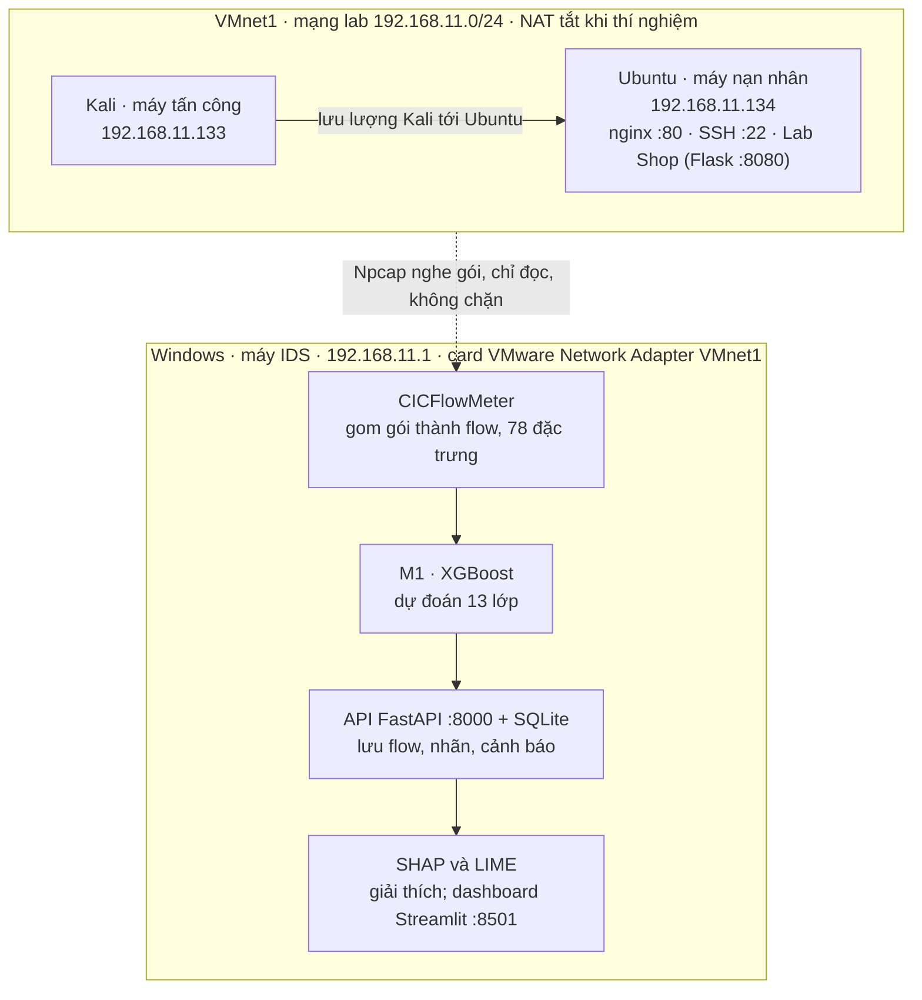

# Hướng dẫn dựng lab IDS: sơ đồ và các lệnh từ đầu đến hiện tại

Cập nhật: 04/11/2026

## 1. Mục tiêu và tình trạng hiện tại

Lab ba máy đã chạy được phần bình thường: Kali gửi lưu lượng web tới Ubuntu, IDS trên Windows bắt qua card VMnet1 và model M1 gán nhãn Benign. Chưa có lần tấn công nào được chạy.

Mục tiêu của lab là trả lời góp ý của hai thầy: xây một hệ thống xâm nhập hoàn chỉnh (máy tấn công, máy nạn nhân, máy IDS), dùng XGBoost làm bộ phát hiện, dùng SHAP giải thích vì sao một flow bị coi là tấn công, và so sánh dữ liệu thật của lab với tập CSE-CIC-IDS2018.

Đã xong:

- Mạng VMnet1 (host-only, 192.168.11.0/24) nối Kali, Ubuntu và Windows.
- Ubuntu 26.04.1 LTS Desktop chạy nginx, SSH và web Lab Shop (Flask) ở cổng 80.
- Kali ping và curl tới Ubuntu thành công. Wireshark trên Windows thấy lưu lượng giữa hai máy ảo.
- IDS_M1_Lab bắt gói realtime trên VMnet1: lần baseline đầu có 50 flow từ Kali tới Ubuntu, cả 50 đều Benign (đọc từ cơ sở dữ liệu IDS lúc 17:00 ngày 04/11/2026).

Chưa làm:

- Tắt card NAT để cô lập mạng và chụp snapshot `04-victim-ready`.
- Chạy thêm hai lần baseline (cần ít nhất ba lần để tính tỷ lệ báo động giả).
- Thiết kế và chạy thí nghiệm xâm nhập, gán nhãn, đo M0 so với M1, giải thích bằng SHAP.

## 2. Sơ đồ hệ thống lab



Kali gửi lưu lượng tới Ubuntu qua VMnet1; Windows nghe cùng card đó bằng Npcap rồi cho flow đi qua bốn bước: gom flow, M1 dự đoán, lưu cảnh báo, SHAP và LIME giải thích. Hệ thống chỉ phát hiện và cảnh báo, không chặn.

## 3. Bảng máy, IP, cổng và phần mềm

| Máy | Vai trò | IP VMnet1 | Phần mềm chính | Cổng |
| --- | --- | --- | --- | --- |
| Kali (VMware) | Máy tấn công, tạo lưu lượng bình thường | 192.168.11.133 | Chromium, curl, baseline.sh | - |
| Ubuntu 26.04.1 LTS Desktop (VMware) | Máy nạn nhân | 192.168.11.134 | nginx, OpenSSH, web Lab Shop (Flask + gunicorn) | 80, 22, 8080 (chỉ nội bộ) |
| Windows (máy thật) | Máy IDS | 192.168.11.1 | Npcap, Wireshark, IDS_M1_Lab | 8000 (API), 8501 (dashboard), chỉ 127.0.0.1 |

Nhiễu nền cần biết khi gán nhãn: Kali hỏi DNS (UDP 53) tới 192.168.11.1 để đồng bộ giờ, và Ubuntu gửi mDNS (UDP 5353) tới 224.0.0.251. Hai loại này bị loại khỏi bảng chấm điểm.

Tài khoản web thử nghiệm: `labdemo` / `Lab-Pass-01`. Đây là tài khoản giả, chỉ dùng trong lab.

## 4. Phần A: VMware và hai card mạng

Mỗi máy ảo cần hai card: một card NAT để ra internet khi cài gói, một card VMnet1 (host-only) là mạng lab. Windows nhìn thấy VMnet1 qua card "VMware Network Adapter VMnet1" (192.168.11.1).

1. Tắt máy ảo. Vào **VM → Settings**.
2. **Network Adapter** (card 1): chọn **NAT**.
3. **Add → Network Adapter** (card 2): chọn **Custom: Specific virtual network → VMnet1 (Host-only)**.
4. Cả hai card tick **Connected** và **Connect at power on**.
5. Với Ubuntu: cho 4096 MB RAM, 2 CPU; bỏ tick **Share Bluetooth devices with the virtual machine** (mục USB Controller) và bỏ **Accelerate 3D graphics** (mục Display) nếu máy kẹt ở màn hình khởi động. Các dòng lỗi Bluetooth hci0 chỉ là cảnh báo vô hại.
6. Bật máy, mở terminal và kiểm tra địa chỉ:

```
ip -br addr
```

Đúng là thấy hai card có IP: một dòng 192.168.52.x (NAT) và một dòng 192.168.11.x (VMnet1). Trên Ubuntu card VMnet1 tên `ens37`, trên Kali là `eth1`.

Vì sao chọn Ubuntu 26.04 LTS: bản 25.04 đã hết hỗ trợ từ tháng 1/2026, bản 26.10 chỉ là bản ngắn hạn. LTS (Long Term Support) được cập nhật bảo mật khoảng 5 năm nên ổn định hơn cho lab kéo dài nhiều tuần.

## 5. Phần B: Ubuntu, web Lab Shop và nginx

Ubuntu chạy nginx ở cổng 80 đứng trước web Lab Shop (Flask chạy bằng gunicorn ở 127.0.0.1:8080) và dịch vụ SSH ở cổng 22. Làm khi card NAT còn bật, vì cần tải gói.

**B1. Cài gói** (nếu `apt` báo `Waiting for cache lock`, đó là Ubuntu đang tự cập nhật ngầm: chờ 5 đến 10 phút, không nhấn Ctrl+C):

```
sudo apt update
sudo apt install -y openssh-server nginx python3-venv tcpdump curl
sudo systemctl enable --now ssh nginx
systemctl is-active ssh nginx
```

**B2. Lấy file web từ Windows sang Ubuntu.** File nằm ở `C:\Users\LOQ\Downloads\SELF_KLTN\lab_data\labweb\app.py`. Trên Windows (PowerShell, không cần quyền Admin):

```
cd C:\Users\LOQ\Downloads\SELF_KLTN\lab_data\labweb
python -m http.server 9000 --bind 192.168.11.1
```

Trên Ubuntu:

```
mkdir -p ~/labweb && cd ~/labweb
curl -O http://192.168.11.1:9000/app.py
ls -l app.py
```

Xong thì quay lại PowerShell nhấn Ctrl+C để tắt máy chủ tạm.

**B3. Tạo môi trường Python và chạy thử** (trong `~/labweb`):

```
python3 -m venv venv
./venv/bin/pip install flask gunicorn
./venv/bin/python app.py
```

Ở terminal thứ hai: `curl -I http://127.0.0.1:8080/health` phải ra `200 OK`. Nhấn Ctrl+C ở terminal đầu để dừng.

**B4. Cho web chạy thường trực bằng dịch vụ hệ thống** (tự chạy lại sau khi khởi động và sau khi khôi phục snapshot). Người dùng Ubuntu là `sonnt`; nếu tên khác thì thay `User` và đường dẫn `/home/sonnt`:

```
sudo tee /etc/systemd/system/labweb.service > /dev/null <<'EOF'
[Unit]
Description=Lab Shop web
After=network.target

[Service]
User=sonnt
WorkingDirectory=/home/sonnt/labweb
ExecStart=/home/sonnt/labweb/venv/bin/gunicorn -w 2 -b 127.0.0.1:8080 app:app
Restart=always

[Install]
WantedBy=multi-user.target
EOF
sudo systemctl daemon-reload
sudo systemctl enable --now labweb
systemctl is-active labweb
```

**B5. Đặt nginx đứng trước để web trả lời ở cổng 80:**

```
sudo tee /etc/nginx/sites-available/default > /dev/null <<'EOF'
server {
    listen 80 default_server;
    server_name _;
    location / {
        proxy_pass http://127.0.0.1:8080;
        proxy_set_header Host $host;
        proxy_set_header X-Real-IP $remote_addr;
    }
}
EOF
sudo nginx -t
sudo systemctl reload nginx
curl -I http://localhost/health
```

Đúng là `nginx -t` báo `syntax is ok`, và `curl` ra `HTTP/1.1 200 OK`.

Web Lab Shop có các trang: `/` (trang chủ), `/products`, `/product/<id>` (8 sản phẩm), `/search?q=`, `/contact` (form), `/about`, `/big` (trang dài), `/login` (đăng nhập) và `/dashboard`, `/api/products`, `/health`. Web được viết cố ý không có lỗ hổng.

## 6. Phần C: Kali, trình duyệt không proxy và baseline.sh

Kali kiểm tra mạng bằng dòng lệnh trước, rồi mới dùng trình duyệt. Firefox trên Kali báo `The proxy server is refusing connections` vì đang ép dùng proxy; `curl` không bị ảnh hưởng, nên dùng Chromium với cờ bỏ proxy.

**C1. Kiểm tra mạng từ Kali:**

```
ip -br addr
ping -c 3 192.168.11.134
curl -I http://192.168.11.134/health
curl -s http://192.168.11.134/ | head -n 5
```

Đúng là: `eth1` có 192.168.11.133, ping `3 received`, `curl` ra `200 OK` và thấy HTML của Lab Shop.

**C2. Mở web bằng Chromium, bỏ qua proxy:**

```
chromium --no-proxy-server http://192.168.11.134 &
```

**C3. Kịch bản lưu lượng bình thường `baseline.sh`.** Mỗi lệnh `curl` mở một kết nối TCP mới nên cho ra nhiều flow, khác với trình duyệt dùng lại một kết nối (keep-alive) nên chỉ cho vài flow:

```
cat > ~/baseline.sh <<'EOF'
#!/bin/bash
B=http://192.168.11.134
for i in $(seq 1 40); do
  for p in / /products /product/1 /product/3 "/search?q=chuot" /about /contact /big /api/products; do
    curl -s -o /dev/null "$B$p"
    sleep $(awk 'BEGIN{srand(); print 0.3+rand()*1.2}')
  done
  curl -s -o /dev/null -d "u=labdemo&p=Lab-Pass-01" "$B/login"
done
EOF
chmod +x ~/baseline.sh
~/baseline.sh
```

Script chạy khoảng 6 đến 10 phút và không in gì; khi trả lại dấu nhắc lệnh là đã xong. Ghi giờ bắt đầu và kết thúc theo đồng hồ Windows.

## 7. Phần D: IDS trên Windows, bắt gói và xuất CSV

IDS_M1_Lab là bản chạy của hệ thống RQ3 với model M1 (XGBoost, 13 lớp). Luồng xử lý: Npcap nghe gói trên card VMnet1, CICFlowMeter gom gói thành flow và tính 78 đặc trưng, FastAPI đưa vào M1 để dự đoán, kết quả lưu SQLite và hiển thị trên Streamlit; SHAP và LIME giải thích các flow bị cảnh báo.

**D1. Khởi động.** Mở PowerShell bằng quyền Administrator:

```
cd C:\Users\LOQ\Downloads\SELF_KLTN\IDS_M1_Lab
.\run_ids.ps1
```

Chờ khoảng 20 giây. Hai cửa sổ PowerShell mới (API và dashboard) sẽ mở, không đóng chúng khi đang capture. Chỉ chạy một lần mỗi buổi làm việc.

**D2. Bắt capture.**

1. Mở `http://127.0.0.1:8501`, vào tab **Realtime**.
2. Ô Interface: chọn **VMware Network Adapter VMnet1**. Sau khi khởi động lại, ô này mặc định quay về **Wi-Fi**, dễ quên đổi.
3. Bấm **Bắt đầu capture**. Dòng `Packet đã nhận` phải tăng dần.
4. Ghi giờ bắt đầu theo đồng hồ Windows.

**D3. Sau khi chạy.** Chờ 3 phút để CICFlowMeter xuất nốt các flow (flow chỉ xuất khi kết nối đóng hoặc hết thời gian chờ, mặc định khoảng 90 giây). Rồi bấm biểu tượng tải xuống ở góc phải trên của bảng Realtime để lưu CSV vào `C:\Users\LOQ\Downloads\SELF_KLTN\lab_data\`, đặt tên theo lần chạy (ví dụ `baseline_script_01.csv`). Sau đó bấm **Dừng capture** và đóng hai cửa sổ PowerShell.

**D4. Wireshark kiểm tra đường đi.** Chọn card VMnet1, ô lọc:

```
ip.addr == 192.168.11.133 && ip.addr == 192.168.11.134
```

Đạt khi thấy ICMP và HTTP giữa Kali và Ubuntu. Nếu không thấy, phương án dự phòng là chạy `sudo tcpdump -i ens37 -w ~/lab.pcap host 192.168.11.133` trên Ubuntu rồi phát lại file PCAP vào IDS.

**D5. Nhật ký.** Mỗi lần chạy ghi một dòng vào `lab_data\nhat_ky_thi_nghiem.csv` với các cột: `run_name, loai, nhom, muc, lan, gio_bat_dau_vn, gio_ket_thuc_vn, ip_nguon, ip_dich, cong_dich, file_csv, file_pcap, ghi_chu`.

## 8. Phần E: cô lập mạng và snapshot

Trước khi chạy bất kỳ thí nghiệm tấn công nào, phải tắt card NAT trên cả hai máy ảo để lưu lượng thí nghiệm chỉ đi trong VMnet1 và không thể ra ngoài. Snapshot cho phép quay về trạng thái sạch sau mỗi lần chạy.

1. Tắt cả hai máy (Ubuntu: `sudo poweroff`; Kali: menu tắt máy).
2. Với từng máy: **VM → Settings → Network Adapter** (card NAT), bỏ tick **Connected** và **Connect at power on**. Giữ nguyên card VMnet1.
3. Bật lại hai máy, gõ `ip -br addr`: chỉ còn card VMnet1 có IP 192.168.11.x.
4. Từ Kali: `curl -I http://192.168.11.134/health` phải ra `200 OK` (web tự chạy lại sau khi khởi động).
5. Chụp snapshot cho cả hai máy: **VM → Snapshot → Take Snapshot**, đặt tên `04-victim-ready`.

Các mốc snapshot nên có: `01-clean-lab` (sau khi cài xong gói), `02-baseline-ok` (sau lần baseline đầu), `04-victim-ready` (mạng cô lập + web chạy). Mỗi lần chạy thí nghiệm bắt đầu từ `04-victim-ready`.

## 9. Các lỗi đã gặp và cách sửa

| Triệu chứng | Nguyên nhân | Cách sửa |
| --- | --- | --- |
| Ubuntu kẹt ở màn hình khởi động, thấy dòng `Bluetooth: hci0 ... failed` | Cảnh báo vô hại của Bluetooth ảo; lần khởi động đầu của bản Desktop chậm | Chờ 3 đến 5 phút; nếu vẫn kẹt thì tắt cứng, bỏ Share Bluetooth, bỏ 3D graphics, cấp 4 GB RAM |
| `apt` báo `Waiting for cache lock ... held by process (aptd)` | Ubuntu đang tự cập nhật ngầm | Chờ 5 đến 10 phút, không nhấn Ctrl+C, không xóa file lock |
| Firefox trên Kali: `The proxy server is refusing connections` | Firefox đang ép dùng proxy không chạy | Dùng `chromium --no-proxy-server http://192.168.11.134 &`; `curl` không bị ảnh hưởng |
| Dashboard báo `Cần đối soát tiến trình` và `supervisor_restarted_requires_reconciliation` | Phiên capture trước bị ngắt giữa chừng (API đóng hoặc chạy lại `run_ids.ps1`) | Bấm **Đối soát sau restart**; nếu vẫn còn thì đóng cả hai cửa sổ PowerShell, chờ 10 giây, chạy lại `run_ids.ps1`. Không xóa journal, không kill PID tùy ý |
| Dashboard bắt nhầm card (mặc định Wi-Fi) | Ô Interface quay về Wi-Fi sau mỗi lần khởi động | Đổi sang VMware Network Adapter VMnet1 trước khi bấm Bắt đầu capture |
| Duyệt web nhiều nhưng chỉ thấy 2 flow | Trình duyệt dùng lại một kết nối TCP; flow chỉ xuất khi kết nối đóng hoặc sau khoảng 90 giây; DNS lấp bảng | Dùng `baseline.sh`, đóng trình duyệt, chờ 3 phút, lọc theo đích 192.168.11.134 |
| Thấy IP khác (192.168.11.1, 224.0.0.251) trong bảng flow | Nhiễu nền: DNS/NTP của Kali và mDNS của Ubuntu | Bình thường; loại khỏi bảng chấm điểm khi gán nhãn |

## 10. Kế hoạch tiếp theo: thiết kế thí nghiệm xâm nhập

Bước tiếp theo là hoàn tất baseline, cô lập mạng, rồi thiết kế và chạy các lần tấn công có mức độ khó tăng dần. Tài liệu này chỉ mô tả cách tổ chức thí nghiệm, ghi nhật ký, gán nhãn và đo kết quả; cách vận hành công cụ tấn công do bạn làm theo tài liệu môn học.

1. **Hoàn tất baseline:** chạy `baseline.sh` ít nhất 3 lần, lưu CSV, ghi nhật ký.
2. **Cô lập mạng và snapshot** `04-victim-ready` (Phần E).
3. **Chọn nhóm hành vi** khớp nhãn của M1: G1 dò mật khẩu SSH (cổng 22), G2 dò mật khẩu đăng nhập web (cổng 80), G3 DoS HTTP tốc độ cao, G4 DoS kiểu chậm (Slowloris), G5 dò quét cổng (ngoài tập huấn luyện). Các lớp Bot, Infilteration, DDoS HOIC, DDoS LOIC-UDP, SQL Injection, Brute Force-XSS không tái tạo được trung thực bằng một máy Kali và web không có lỗ hổng, nên ghi vào phần hạn chế.
4. **Ba mức độ khó** cho mỗi nhóm: mức 1 tốc độ cao, rõ ràng; mức 2 tốc độ trung bình, có ngắt quãng; mức 3 tốc độ thấp, kéo dài, chạy cùng lưu lượng bình thường.
5. **Số lần chạy:** mỗi tổ hợp (nhóm × mức) chạy 3 lần, tức 5 × 3 × 3 = 45 lần, mỗi lần khoảng 10 phút gồm cả thời gian chờ. Chạy thử 1 lần mỗi nhóm trước.
6. **Gán nhãn:** flow nguồn 192.168.11.133, đích 192.168.11.134, đúng cổng của nhóm và nằm trong khoảng giờ của lần chạy thì mang nhãn nhóm; flow DNS và mDNS bị loại.
7. **Đo M0 so với M1:** tỷ lệ phát hiện theo nhóm và mức, tỷ lệ báo động giả trên baseline, ma trận nhầm lẫn.
8. **Giải thích:** SHAP lấy 5 đặc trưng đứng đầu cho mỗi nhóm bị phát hiện; LIME chỉ nêu đặc trưng nổi bật nhất vì hai phương pháp tính khác nhau (LIME vẫn còn các đặc trưng khác với trọng số nhỏ hơn); so sánh với phân phối của lớp tương ứng trong CSE-CIC.

Quy tắc an toàn: chỉ chạy khi NAT đã tắt, chỉ nhắm vào 192.168.11.134, khôi phục snapshot sau mỗi lần chạy, đồng hồ ba máy lệch nhau dưới vài giây.
